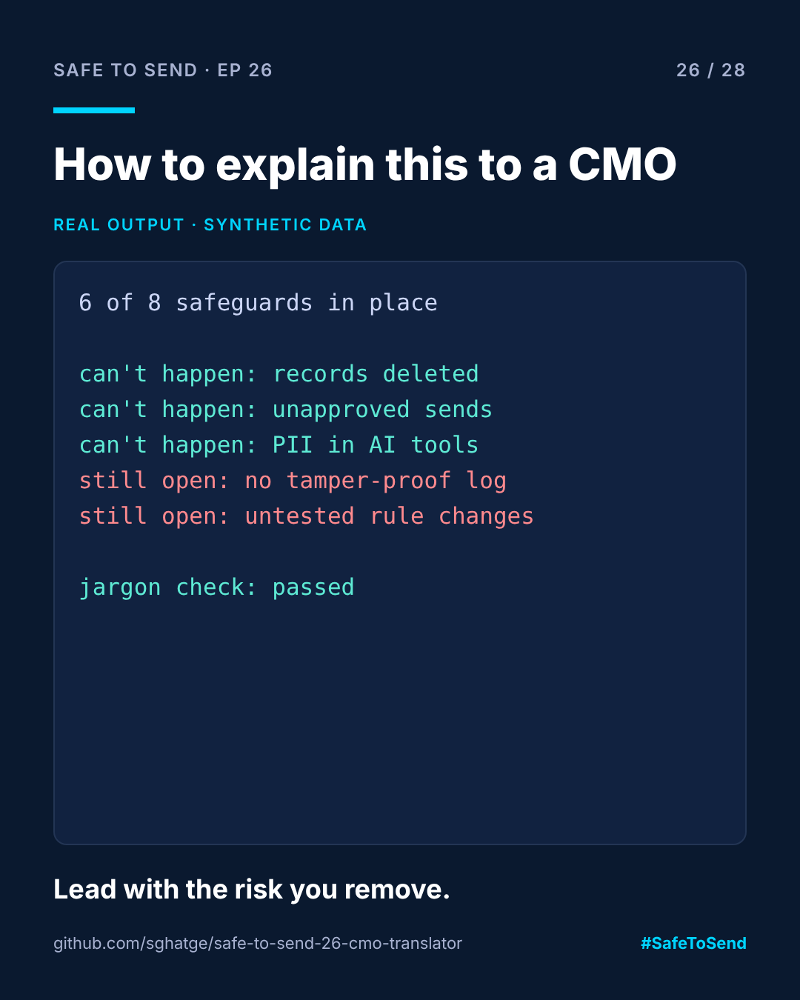

# safe-to-send-26 · Explain It to a CMO



**Safe to Send · Episode 26** — a 28-day learn-in-public series on governing AI in CRM operations.

> Nobody in a marketing leadership meeting wants to hear about MCP.

## The real-world scenario

The CRM lead presents the AI governance work to the CMO: policy-as-code, a gateway, hash-chained audit, invariant tests in CI. Five minutes in, the CMO asks the only question they came with: "So can it send something embarrassing to our customers or not?" Nobody has a one-line answer.

## The use case

Map every technical control to the business risk it removes, in words a leadership team uses. Generate a one-page brief from the real setup:

- **What can no longer happen** (controls that are on)
- **What could still happen** (controls that are off, stated as risks, not features)
- **Decisions we need from you** (what leadership owns, not the team)

Then refuse to print it if any jargon slipped in: MCP, YAML, hash, SQL, API, CI, LLM, PII and friends.

## Run it

```bash
python cmo_brief.py examples/q4_setup.json
```

## Real example output (excerpt)

```
**In one line:** 6 of 8 safeguards are in place. 2 risk(s) remain open and need a decision.

## What can no longer happen
- The assistant deleting or changing customer records: the assistant can read data but never change it.
...
## What could still happen
- Not being able to prove what happened after an incident.
- A small rule change quietly removing a safeguard.
```

The jargon check is the surprising part: writing the control descriptions so they pass it forced me to explain each one in terms of what it prevents, which is the only thing leadership cares about.

MIT · [Sangram Ghatge](https://www.linkedin.com/in/sangram-g-2369705b) · #SafeToSend
